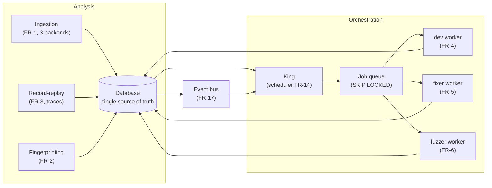
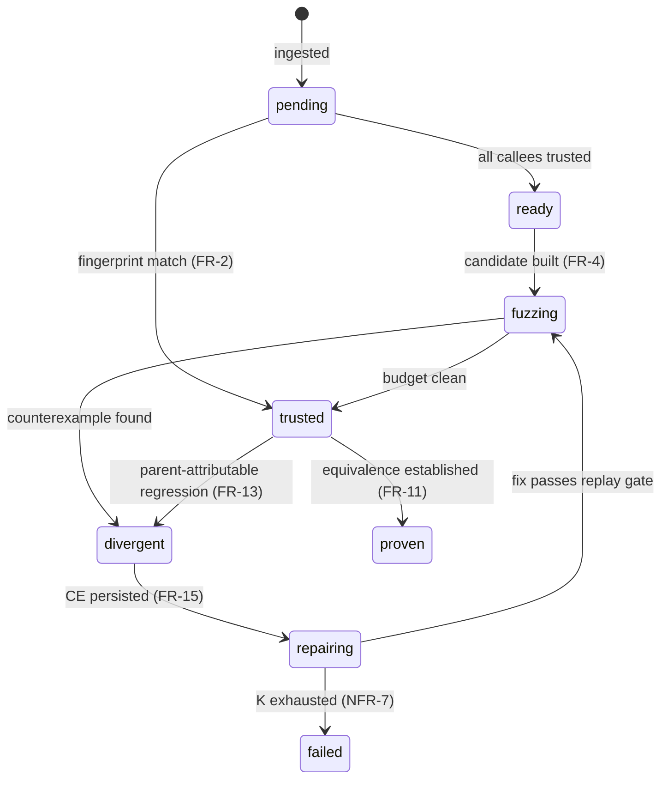

# Architecture

bindumpty is a pipeline of small, testable stages coordinated by a
database. Nothing coordinates in memory: the DB is the single source of
truth, and the append-only `events` table doubles as the message bus.

## The big picture

## The CEGIS loop

The core cycle, per function, driven by the 8-state machine
(`humpty.domain.State`):

Key invariant: every transition is written to `events` in the same
transaction as the state change, so a rollback removes the event too — the
bus can never describe a state that did not commit.

## The three validation layers

| Layer | Mechanism | Guarantees | Module |
|---|---|---|---|
| Differential fuzzing | libFuzzer persistent mode, original vs candidate on every input | finds *branch-visible* divergences; ~128k exec/s | `horses/src/m1_harness.c` |
| Trace replay | recorded ground-truth I/O (FR-3) replayed through the candidate | catches branch-free wrongness the fuzzer cannot see | `horses/src/harness_driver.py` |
| Equivalence proof | both sources to LLVM IR; bounded induction over the fold (FR-11) | *proven*, not merely non-refuted | `humpty/analyze/prove.py` |

The M1 lesson that shaped this design: a `hash ^= 0x00` seed bug survived
**8 million** fuzzer executions because it changes no control flow. Fuzzing
alone proves nothing; the three layers together are the oracle
(see `horses/src/NOTES_m1.md`).

## Source-language adaptation

The pipeline detects whether the binary was built from C or C++ (two tiers:
an ELF pre-filter plus Ghidra as the authority) and adapts: RTTI/vtable
recovery, the C++ fingerprint corpus, class-layout registry, demangling.
The *validation* machinery is deliberately language-agnostic — see
`humpty/analyze/detect_lang.py` and `humpty/analyze/adapt.py`.

## Multi-backend ingestion

Three interchangeable backends emit the same `fuz.call-graph/1` contract:
Ghidra headless (the authority for language detection), objdump (always
available), rizin (static binary, pinned). `compare_backends` cross-checks
two graphs against each other — an edge disagreement is a cheap pre-LLM
signal. See `analysis/exporters/`.
